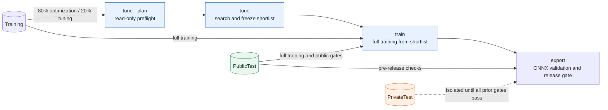

# sentience-train

[](https://www.python.org/)
[](https://docs.astral.sh/uv/)
[](https://pytorch.org/)
[](https://onnx.ai/)
[](LICENSE)

**A deterministic, reproducible pipeline for tuning, training, and publishing a four-class facial-expression classifier as ONNX FP32.**

| Public input | Public output |
| --- | --- |
| `images` · `uint8` · NHWC `[N, 48, 48, 1]` | `probabilities` · `float32` `[N, 4]` |

Class order: `angry`, `happy`, `neutral`, `sad`. The ONNX graph includes pixel normalization (`float32(pixel) / 127.5 - 1.0`), NHWC-to-NCHW conversion, the model, and softmax. Callers pass grayscale bytes and receive probabilities.

## Pipeline at a glance



| Phase | Data access | Result |
| --- | --- | --- |
| `tune --plan` | Validates the CSV and deterministic split; reads no `PrivateTest` samples and creates no campaign | Complete plan, identities, batch probes, and conditional tasks as JSON on stdout |
| `tune` | `Training` only; deterministic 80/20 optimization/tuning split | Campaign evidence and a frozen shortlist under `artifacts/campaigns/` |
| `train` | `Training` plus `PublicTest` | Immutable full-training run under `artifacts/runs/` |
| `export` | `PublicTest` for earlier gates; materializes `PrivateTest` only at the final release gate | Validated, benchmarked ONNX bundle under `artifacts/exports/` |

The data scanner may validate `PrivateTest` bytes and row counts, but only the final release gate in `workflows/release.py` can materialize its samples, after the identity ledger and all pre-private gates pass. Predictions are not persisted; release output contains aggregate metrics only.

## Where things live

```text
sentience_train/
├── configs/                  # Versioned training & tuning YAML recipes
├── schemas/                  # Versioned JSON Schemas (v1/v2 public contracts)
├── docs/                     # Architecture context, ONNX contract, and ADRs
├── src/sentience_train/      # Package implementation organized by architectural layer
│   ├── cli.py                # CLI entry point (tune, train, export)
│   ├── core/                 # Domain contracts, FER2013 data, models, recipes, metrics
│   ├── engine/               # Deterministic PyTorch trainer & transactional run staging
│   ├── onnx/                 # ONNX FP32 graph builder, parity check, and host benchmark
│   └── workflows/            # Campaign tuning, full training, release gate, and export
├── tests/                    # Automated test suite organized by scope
│   ├── contracts/            # Fast v2 config, recipe, model, and ONNX contract tests
│   ├── workflows/            # Campaign, training pipeline, and release transaction tests
│   └── acceptance/           # Opt-in real-run benchmark host acceptance tests
├── data/raw/                 # [Local / Git-ignored] Source FER2013 CSV
├── models/pretrained/        # [Local / Git-ignored] SHA-256 validated ImageNet weights
├── artifacts/                # [Local / Git-ignored] Campaigns, runs, and exports
└── reports/                  # [Local / Git-ignored] Test and evaluation reports
```

### Versioned source and contracts · Git-tracked

| Path | What belongs here |
| --- | --- |
| `configs/` | Versioned experiment configuration: `default.yaml` for full training and `tuning.yaml` for the T0–T8 search grid. |
| `schemas/` | Versioned JSON Schemas for inputs, plans, runs, benchmarks, access records, and release bundles. |
| `src/sentience_train/` | Python package organized into `core/`, `engine/`, `onnx/`, and `workflows/`, plus `cli.py`. Top-level `sentience_train.<module>` imports remain supported. |
| `tests/` | Divided into `tests/contracts/`, `tests/workflows/`, and opt-in `tests/acceptance/`. |
| `docs/` | Project context, ONNX-only host contract, and architecture decision records (`docs/adr/`). |
| `README.md`, `CHANGELOG.md`, `LICENSE`, `pyproject.toml`, `uv.lock`, `mise.toml` | Project overview, release history, license, package/tool configuration, and locked environment. |

### Local machine state and artifacts · Git-ignored

| Path | Contents |
| --- | --- |
| `data/raw/` | Local FER2013 source CSV. Only `data/README.md` is tracked. |
| `models/pretrained/` | Locally supplied, hash-validated ImageNet checkpoints. Only `models/README.md` is tracked. |
| `artifacts/campaigns/` | Tuning plans, task evidence, histories, and intermediate checkpoints. |
| `artifacts/runs/` | Immutable full-training runs and selected checkpoints. |
| `artifacts/exports/` | ONNX release bundles and publication ledger. |
| `reports/` | Generated test, benchmark, and evaluation reports. Only `reports/README.md` is tracked. |

Only directory README files are tracked in `data/`, `models/`, `artifacts/`, and `reports/`. Dataset files, weights, checkpoints, models, and generated outputs stay on the local machine.

### Python modules

| Layer / Module | Responsibility |
| --- | --- |
| `cli.py` | Thin command-line adapter for `tune`, `train`, and `export`; maps failures to exit codes. |
| `core/config.py` | Immutable v2 config contracts, schema loading, validation, and canonical hashes. |
| `core/data.py` | FER2013 parsing and validation, partition access, and deterministic tuning split. |
| `core/models.py` | DS-CNN, MobileNetV3-Small, and ResNet-18 construction; pretrained weight filename, size, and SHA-256 validation. |
| `core/recipes.py` | Frozen T0–T8 experiment grid and warmup/cosine learning-rate schedule. |
| `core/metrics.py` | Predictive metrics, quality gates, and stable candidate ordering. |
| `engine/trainer.py` | PyTorch training loop and device/performance settings (AMP, TF32, channels-last). Re-exported under `sentience_train.engine`. |
| `engine/artifacts.py` | Staging and atomic/transactional publication of training run directories. |
| `onnx/onnx_artifact.py` | ONNX graph construction, embedded preprocessing, and PyTorch/ONNX parity validation. |
| `onnx/benchmark.py` | Host latency p95 and resident-memory benchmark. |
| `workflows/campaign.py` | Tuning plan and execution, campaign identity/resume, evidence, and shortlist freezing. |
| `workflows/training.py` | Full training from the frozen shortlist and run publication. |
| `workflows/release.py` | Final gates and exclusive, delayed `PrivateTest` access. |
| `workflows/export.py` | Export orchestration for a completed `run-id`. |

### JSON schemas

| Schema file | Contract |
| --- | --- |
| `onnx-contract-v1.json` | Public ONNX input/output names, dtypes, shapes, opset, embedded normalization, and no external tensor data. |
| `tuning-split-v1.json` | Deterministic `Training` partition split, class counts, indexed row hashes, and split identities. |
| `training-config-v2.json` | Full-training data, model, training, gate, and output configuration. |
| `tuning-config-v2.json` | Architectures, seeds, nine trial recipes, and tuning fraction. |
| `tuning-plan-v2.json` | Read-only plan, resolved configs/environment, tasks, and batch preflight evidence. |
| `tuning-campaign-v2.json` | Campaign state, plan hash, tasks, evidence, and optional frozen shortlist. |
| `training-run-v2.json` | Completed run identity, architecture/recipe/seed, checkpoint, dataset, public metrics, and campaign reference. |
| `host-benchmark-v1.json` | Benchmark host identity, ONNX digest, latency samples and summaries, RSS, and pass/fail reasons. |
| `release-metrics-v2.json` | Aggregate metrics for a public or private test partition, including class scores and confusion matrix. |
| `private-test-access-v2.json` | Reservation/publication ledger entry binding private-test access to a release identity. |
| `release-bundle-v2.json` | Accepted or failed bundle status, run and ONNX identities, payloads, and canonical self-digest. |

## Setup

The environment is pinned in `mise.toml`: Python `3.11.15` and uv `0.11.32`. On Windows, PyTorch and Torchvision resolve from the CUDA 13.0 package index configured in `pyproject.toml`.

```bash
uv sync --locked --group dev
```

Provide the following files locally before running the pipeline:

```text
data/raw/fer2013.csv
models/pretrained/mobilenet_v3_small-047dcff4.pth
models/pretrained/resnet18-f37072fd.pth
```

The CSV must include `emotion`, `pixels`, and `Usage` columns and the `Training`, `PublicTest`, and `PrivateTest` partitions. The two ImageNet checkpoints are validated against expected filenames, sizes, and SHA-256 digests before use. **The pipeline does not download the dataset or weights automatically.**

## Run the pipeline

Run commands from the repository root. The YAML config paths are resolved by the application; use the checked-in config files as shown.

```bash
# 1. Inspect the complete plan without creating campaign state
uv run sentience-train tune --config configs/tuning.yaml --plan

# 2. Execute or resume the campaign with the same plan identity
uv run sentience-train tune --config configs/tuning.yaml

# 3. Train from the completed campaign shortlist
uv run sentience-train train --config configs/default.yaml

# 4. Validate and publish the selected run
uv run sentience-train export --run-id <run-id>
```

`tune --plan` prints the resolved plan as JSON and is read-only. `tune` reuses an incomplete campaign with the same `plan_hash`; a completed campaign produces a frozen shortlist for training. `train` publishes a run atomically. `export` validates and benchmarks the exact ONNX bytes that it publishes. Successful output identifies the campaign, run, or export directory; use the run ID printed by training in the final command.

### Exit codes

| Code | Meaning |
| ---: | --- |
| `0` | Success, including a valid plan, completed/reused tuning campaign, completed training run, or accepted export. |
| `1` | Execution failure, exhausted tuning campaign, or failed release gate/export. |
| `2` | Invalid or incompatible input, including configuration, dataset, or campaign input errors. |

## Training recipes and gates

The tuning configuration evaluates the fixed architectures and seeds against the T0–T8 grid. The normal augmentation profile is horizontal flip probability `0.5`, rotation `5°`, translation `0.04`, scale `0.98–1.02`, brightness `0.10`, and contrast `0.10`. T4 and T5 use stronger augmentation: rotation `10°`, translation `0.08`, scale `0.95–1.05`, brightness `0.15`, and contrast `0.15`.

### Architectures and seeds

| Architecture | Initialization | Learning-rate base | Seeds |
| --- | --- | ---: | --- |
| DS-CNN | Trained from scratch | `1e-3` | `42`, `43`, `44` |
| MobileNetV3-Small | Validated local ImageNet checkpoint | `3e-4` | `42`, `43`, `44` |
| ResNet-18 | Validated local ImageNet checkpoint, adapted for grayscale input | `1e-4` | `42`, `43`, `44` |

### Trial grid

| Trial | Augmentation | Loss | Learning rate | Training policy | Notes |
| --- | --- | --- | --- | --- | --- |
| `T0` | Normal | Weighted cross-entropy (class weight exponent `0.5`) | Base | Full model | Reference recipe. |
| `T1` | Normal | Weighted cross-entropy (`0.5`) | Base | Classifier only | Freezes the feature extractor. |
| `T2` | Normal | Weighted cross-entropy (`0.5`) | Low (`0.5 ×` base) | Full model | Lower learning rate. |
| `T3` | Normal | Weighted cross-entropy (`0.5`) | Low (`0.5 ×` base) | Classifier only | Classifier-only, lower learning rate. |
| **`T4`** | **Strong** | Weighted cross-entropy (`0.5`) | Base | Full model | **Strong-augmentation baseline; strongest observed baseline.** |
| **`T5`** | **Strong** | Weighted cross-entropy (`0.5`) | Base | Full model | **Controlled T4 stability variant:** label smoothing `0.05`, 5 linear warmup epochs, gradient clipping at norm `1.0`. Then cosine decay. |
| `T6` | Normal | Focal loss (`gamma=2`, class weight exponent `0.5`) | Base | Full model | Alternative class-focused loss. |
| `T7` | Normal | Focal loss (`gamma=2`, class weight exponent `0.5`) | Base | Classifier only | Focal loss with frozen feature extractor. |
| `T8` | Normal | Balanced softmax | Base | Full model | Alternative class-balanced loss. |

The configured full-training batch size is `128`. Tuning batch probing may choose another size only when the config explicitly says `auto`; a fixed configured size is never silently changed. Campaign identity includes the canonical recipe/config and relevant local checkpoint identities, so changes produce a distinct plan rather than overwriting earlier results. CUDA execution settings are recorded for reproducibility; bit-for-bit reproducibility across CUDA runs is not promised.

### Quality gates

| Gate | Requirement |
| --- | --- |
| Public predictive performance | `accuracy >= 0.65` and `macro_f1 >= 0.65` on `PublicTest`. |
| Per-class coverage | Recall for every class is `>= 0.55` (`min_recall >= 0.55`). |
| ONNX artifact size | `<= 50 MiB` (`52,428,800` bytes). |
| Host latency | p95 `<= 10 ms` on the release benchmark host. |
| Host memory | RSS increment `<= 128 MiB` (`134,217,728` bytes). |
| PyTorch/ONNX parity | Outputs must match within absolute tolerance `1e-5` and relative tolerance `1e-4`. |

The release is evaluated against the exact staged ONNX artifact later published. `PrivateTest` is opened only after the artifact, identity, public performance, parity, and host resource gates have passed.

## Development

```bash
uv run pytest
uv run ruff check src tests
uv run ruff format --check src tests
uv run mypy src
uv build
```

Acceptance tests that require a real training run and the exact benchmark host are excluded from the default pytest selection. For the detailed partition-access, determinism, and publication contract, see [docs/onnx-only.md](docs/onnx-only.md); see [docs/context.md](docs/context.md) for project concepts and [docs/adr/0001-onnx-only-host-release.md](docs/adr/0001-onnx-only-host-release.md) for the release decision.
